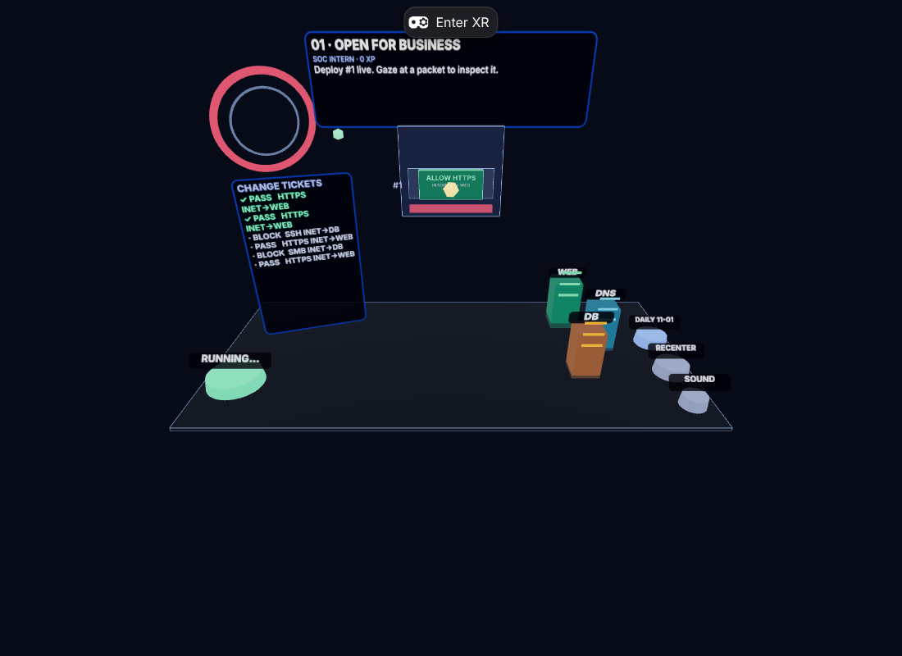
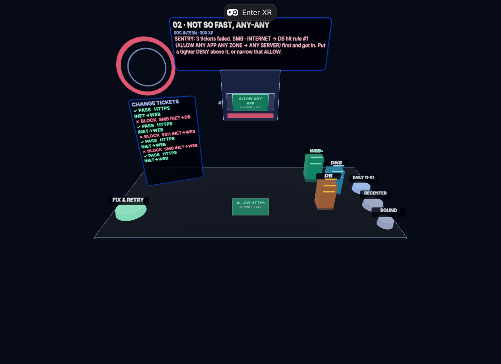
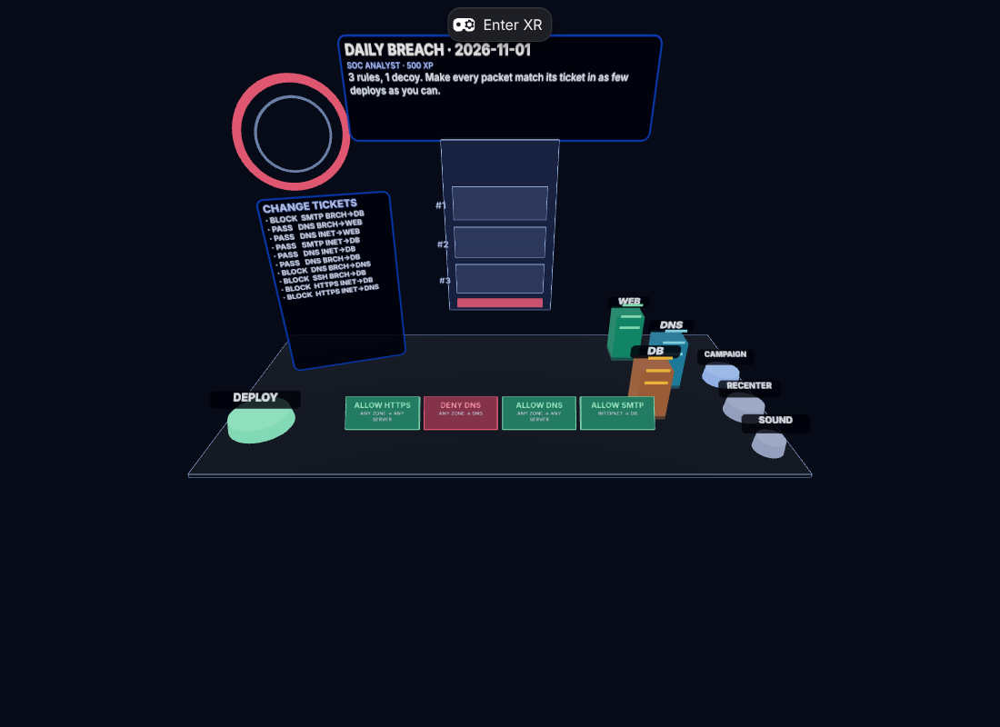
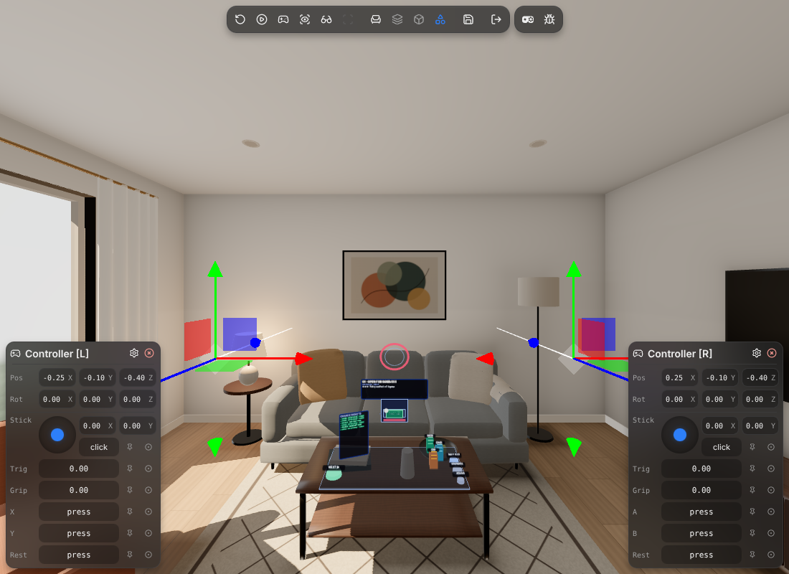
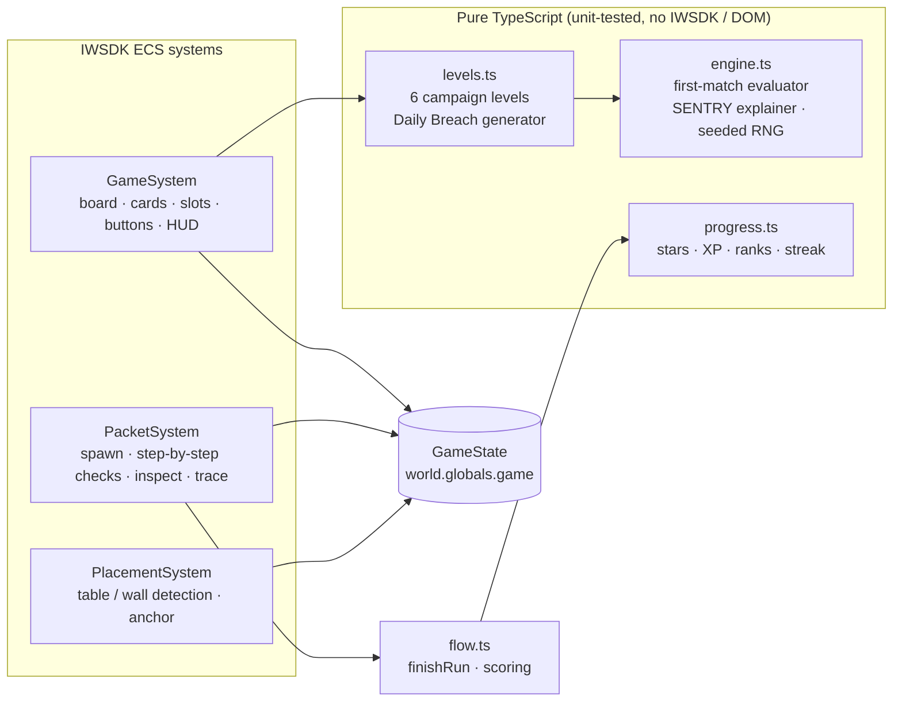

<div align="center">

# PACKETFALL

### Threats pour through your real wall. You are the firewall on your desk.

A hands-first, seated **mixed-reality puzzle game** for **Meta Quest 3 / 3S** and **Meta VR Glasses**,
built with Meta's **Immersive Web SDK (IWSDK / WebXR)**.

*Meta VR Start Developer Competition 2026 · Gaming track · New Experience division*

[](https://github.com/natrajexplore/packetfall_meta/actions/workflows/deploy.yml)


**▶ Play now:** **https://natrajexplore.github.io/packetfall_meta/**
<br/><sub>Open in Meta Quest Browser → <b>Enter mixed reality</b>. Works in a desktop browser too.</sub>

</div>

---

## Contents

- [The pitch](#the-pitch)
- [Screenshots](#screenshots)
- [How to play](#how-to-play)
- [Controls](#controls)
- [Campaign, Daily Breach & progression](#campaign-daily-breach--progression)
- [How it uses Meta VR](#how-it-uses-meta-vr)
- [UX details that make it feel seamless](#ux-details-that-make-it-feel-seamless)
- [Architecture](#architecture)
- [Getting started (development)](#getting-started-development)
- [Testing](#testing)
- [Deploying](#deploying)
- [Troubleshooting](#troubleshooting)
- [Changelog](#changelog)
- [License & assets](#license--assets)

---

## The pitch

You build a firewall policy by **pinching rule cards into a rule stack**. Hit **DEPLOY** and glowing packets stream out of a portal on your *actual* wall, land on your *actual* table and walk down your rule stack **one rule at a time**, so you literally *watch* first-match evaluation happen.

Every packet carries a **change ticket** (PASS or BLOCK). Get one wrong and **SENTRY**, the in-game analyst, tells you in one sentence which rule fired and why. Fix it, redeploy, earn stars, climb from **SOC Intern** to **Zero-Trust Legend**, and come back tomorrow for a new **Daily Breach** that every player in the world gets on the same day.

It is a real puzzle about a real skill: **top-down, first-match rule evaluation** is exactly how enterprise firewalls and ACLs decide traffic. No jargon walls: the board teaches it.

## Screenshots

| Deploy in progress | SENTRY explains a mistake |
|---|---|
|  |  |
| **Daily Breach** | **Mixed reality on a real coffee table** |
|  |  |

## How to play

1. **Sit at a desk or table** and open the game in Meta Quest Browser. Pinch **Enter mixed reality**.
2. The board **finds your table** (or floats in front of you as a tray) and a portal **opens on your wall**.
3. **Pinch a rule card**: it lifts and glows. **Pinch a slot** in the firewall: the card snaps in.
4. Pinch **DEPLOY**. Packets fly in and are checked **top-down, one rule at a time**:
   - the **first matching rule** decides: ALLOW sends it to its server, DENY shatters it;
   - nothing matches → the red **default-deny** bar drops it.
5. The **Change Tickets** panel scores every packet: ✓ correct, ✗ **BREACH** (let in something that should be blocked) or ✗ **OUTAGE** (blocked something that should pass).
6. Read SENTRY's one-line explanation, pinch **FIX & RETRY**, rearrange, redeploy. Solve it in fewer deploys for more stars.

> **The one rule to remember:** *rules are checked top-down and the first match wins.* A broad ALLOW above a narrow DENY means the DENY never fires.

## Controls

No controller is ever required. Every target is a ray-interactable, so hands, gaze, controllers and the mouse all drive the same flow.

| Action | Hands (Quest) | Eyes + hands (VR Glasses) | Desktop |
|---|---|---|---|
| Select a rule card | Point and pinch | Look and pinch | Click |
| Place it | Pinch an empty slot | Look at slot, pinch | Click |
| Return a placed card | Pinch it (or its slot) again | Look, pinch | Click |
| Inspect a packet | Point at it | Look at it | Hover |
| Slow-mo trace a packet | Pinch it | Look, pinch | Click |
| Deploy / Next / Retry | Pinch the big button | Look, pinch | Click |
| Switch Campaign ⇄ Daily | Pinch **DAILY** / **CAMPAIGN** | Look, pinch | Click |
| Move the board | Pinch **RECENTER** | Look, pinch | Click |
| Mute / unmute (remembered) | Pinch **SOUND** | Look, pinch | Click |

The big button's colour always tells you what it will do:

| Colour | Label | Meaning |
|---|---|---|
| 🟢 green | **DEPLOY** | Run your current policy |
| ⚪ grey | **RUNNING…** | Packets in flight, so the rules are locked |
| 🟠 amber | **FIX & RETRY** | Some tickets failed; your layout is kept so you can fix it |
| 🔵 blue | **NEXT ▶ / DAILY ▶ / CAMPAIGN ▶** | Solved: move on |

## Campaign, Daily Breach & progression

### Campaign: six hand-built lessons

| # | Level | What it teaches |
|---|---|---|
| 01 | **Open for Business** | One ALLOW rule, guided tutorial with pulsing hints |
| 02 | **Not So Fast, Any-Any** | Why `ALLOW ANY` is a trap |
| 03 | **First Match Wins** | Order matters: specific ALLOW above a broad DENY |
| 04 | **Names Before Numbers** | Keep the web up *and* DNS answering |
| 05 | **Lateral Movement** | Shield the DB from the internet, keep it open to the branch |
| 06 | **Shadowed** | Spot a rule hidden behind a broader one |

Beat level 06 and the big button becomes **DAILY ▶**, which takes you straight to today's Daily Breach.

### Daily Breach

A new puzzle every calendar day, **generated deterministically from the date**, so every player worldwide gets the same one. The generator guarantees that every rule in the answer matters, that both allowed and denied traffic appear, and that the puzzle can't be solved by dropping the cards in dealt order or reversing them. The test suite checks a full year of dailies.

### Stars, XP and ranks

| Stars | Earned when |
|---|---|
| ★★★ | Solved on the first deploy |
| ★★☆ | Solved on the second deploy |
| ★☆☆ | Solved later |

Campaign stars grant **100 XP each** (only improvements count). A Daily win grants **150 XP + 50 per star + 25 per streak day** (capped at 10 days).

| XP | Rank |
|---|---|
| 0 | SOC Intern |
| 400 | SOC Analyst |
| 1,200 | Network Engineer |
| 2,500 | Security Engineer |
| 4,500 | Security Architect |
| 7,500 | Zero-Trust Legend |

Progress, streak and the mute setting are saved on the device (`localStorage`). Private windows or blocked storage never break the game; progress then lasts for the session.

## How it uses Meta VR

| Capability | Where it shows up |
|---|---|
| **Hand tracking** | Every interaction is a pinch on a `RayInteractable`; fully playable without pairing a controller. |
| **Gaze interaction** | `gazeTracking` enabled; gaze + pinch reaches the same targets. Looking at a packet shows its header. |
| **Passthrough, purposefully** | Packets enter through a portal pinned to *your* wall and fall onto *your* table. The room is the level. |
| **Scene understanding** | `PlacementSystem` looks for a semantic `table`/`desk` mesh, then a desk-height horizontal plane in front of you, and falls back to a floating tray. A ray against vertical planes finds the wall for the portal. |
| **Reach-aware placement** | A detected table is used only if the board lands within comfortable arm's reach (≤ 0.75 m away, ≤ 0.75 m below your head). Otherwise you get the tray, never an unreachable board. |
| **Spatial anchors** | The board is attached to an `XRAnchor`, so it stays glued to the table through tracking drift; **RECENTER** moves it within the anchored space. |
| **FoV-aware design** | All interactive pieces sit on a ~0.86 m × 0.42 m board in a narrow forward cone, so they fit the Meta VR Glasses' narrower field of view. |
| **Seated / airplane-seat test** | Every target is within arm's reach of a seated player; no locomotion. |
| **Fast cold start** | Zero downloaded assets: every mesh is procedural and every sound is synthesized with WebAudio. |
| **Clean pause/resume** | The simulation freezes on `Hidden` / `VisibleBlurred` (headset off, system menu open). |

## UX details that make it feel seamless

- **Hover before you commit:** cards, slots and buttons grow or brighten when a hand ray or gaze is on them.
- **State you can read at a glance:** the button colour, a **green/red HUD border** and a **portal ring that turns green or red** on the result.
- **The goal never disappears:** the HUD always shows the level brief; live guidance and SENTRY feedback get their own highlighted line.
- **Text always fits:** canvas labels auto-shrink long SENTRY explanations instead of clipping them.
- **Feedback for "nothing happened" moments:** touching cards mid-deploy, deploying an empty firewall or pinching an empty slot each explain themselves.
- **Ticket scoreboard:** `TICKETS 5/8`, with every failure labelled **BREACH** or **OUTAGE**.
- **Friendly landing page:** the button stays in a *Loading…* state until the world is ready, a failed XR launch falls back to the in-browser board, and leaving the headset offers **Re-enter mixed reality**.
- **Accessible audio:** procedural, short and never essential; mute is one pinch and remembered.

## Architecture



- **ECS (entity-component system):** game objects are entities with small data components (`RuleCard`, `RuleSlot`, `Packet`, …) declared in the system-free `src/components.ts`; behaviour lives in systems that react to queries such as `Pressed` and `Hovered`.
- **Rendering:** everything is procedural Three.js (re-exported by `@iwsdk/core`); text is drawn to canvas textures, so no font assets are needed.
- **`iwsdk.config.json`** is the project authority: it selects the XR mode (`ar`), features (hands, gaze, planes, meshes, anchors) and the emulator device.

### Project layout

```
iwsdk.config.json                XR features — the project authority
index.html                       2D landing page + Enter MR button
src/index.ts                     World.create + system registration + landing overlay
src/components.ts                ECS components (system-free manifest)
src/game/engine.ts               Pure first-match rule engine, SENTRY explainer, seeded RNG
src/game/levels.ts               6 campaign levels + deterministic Daily Breach generator
src/game/progress.ts             XP, ranks, stars, daily streak, mute (localStorage, fail-safe)
src/game/board.ts                Board layout + procedural meshes
src/game/labels.ts               Auto-fitting canvas-texture text panels
src/game/sfx.ts                  Procedural WebAudio sound effects
src/game/flow.ts                 Level choice, deploy completion, scoring
src/game/state.ts                Shared cross-system game state
src/systems/game-system.ts       Cards, slots, buttons, HUD, tickets, hover, tutorial guidance
src/systems/packet-system.ts     Packet spawn, step-by-step rule evaluation, gaze inspect, trace
src/systems/placement-system.ts  Table/wall detection, reach check, board placement, anchoring
tests/engine.test.ts             Engine + level + 365-day daily-generator tests
docs/                            Rules analysis, submission text, video script, build plan, QA
```

## Getting started (development)

**Requirements:** Node.js **22.18+** (or 24+). The tests run the `.ts` files directly, which needs Node's built-in TypeScript type stripping.

```bash
git clone https://github.com/natrajexplore/packetfall_meta.git
cd packetfall_meta
npm install
npm run dev        # managed browser + IWER headset emulator with a virtual living room
```

`npm run dev` opens a managed Chromium window running **IWER**, IWSDK's browser-based XR emulator, so you can play with the mouse or drive emulated hands and controllers. Stop it with `npm run dev:down`.

| Script | What it does |
|---|---|
| `npm run dev` | Start the CLI-managed dev server + emulator |
| `npm run dev:status` | Show server status and LAN URLs for a headset |
| `npm run dev:down` | Stop the dev server |
| `npm run typecheck` | `tsc --noEmit` (strict) |
| `npm test` | Rule engine, levels, and a full year of daily puzzles |
| `npm run build` | Production build into `dist/` |
| `npm run check` | Typecheck + tests + build: run before every push |

### On a real headset

1. Put the Quest on the same Wi-Fi as your computer.
2. Run `npx @iwsdk/cli dev status` and open a URL from `data.runtimeUrls.network` in Meta Quest Browser.
3. Accept the local development certificate warning, then pinch **Enter mixed reality**.

For a Quest connected over USB, or for Meta VR Glasses (gaze + pinch, narrower field of view), see the [IWSDK testing guide](https://iwsdk.dev/guides/02-testing-experience.html).

## Testing

```bash
npm run check
```

- **Unit tests** (`tests/engine.test.ts`): first-match evaluation, default deny, empty slots, outcome judging, SENTRY wording, campaign solvability, and **365 consecutive Daily Breach puzzles** for determinism and non-triviality.
- **Manual QA checklist:** see [`docs/TESTING.md`](docs/TESTING.md).

## Deploying

The repo ships with `.github/workflows/deploy.yml`, which typechecks, tests, builds and publishes `dist/` to **GitHub Pages** on every push to `main`.

1. In **Settings → Pages**, set **Source** to **GitHub Actions** (one-time).
2. Push to `main`. The workflow publishes to **https://natrajexplore.github.io/packetfall_meta/**.
3. Use that URL in the competition submission. WebXR needs HTTPS, and Pages provides it.

The Vite `base` is `./`, so the build works from any sub-path.

## Troubleshooting

| Symptom | Fix |
|---|---|
| Board is floating instead of on my table | Run Quest **Space Setup** so the table is labelled, sit within reach, then pinch **RECENTER**. |
| Board is in an awkward spot | Look where you want it and pinch **RECENTER**. |
| No **Enter mixed reality** button, only *Play in browser* | The browser has no WebXR. Use Meta Quest Browser, or play with the mouse. |
| Page says *could not start* | WebGL is required; use Meta Quest Browser or a recent Chrome/Edge. |
| No sound | Sound starts after your first pinch or click (browser autoplay rules). Check the **SOUND** button isn't OFF. |
| Progress lost | You're in a private window or site data was cleared; progress is stored per device. |
| `npm test` fails with a syntax error | Upgrade Node to 22.18+ (TypeScript type stripping). |

## Changelog

### UX & reliability pass
- **Fixed:** the level brief was hidden after board placement in mixed reality; it's now always on the HUD.
- **Fixed:** placement or recenter messages could overwrite SENTRY's failure explanation or the tutorial steps.
- **Fixed:** slot hit-flash colours stuck after a run ended.
- **Fixed:** beating the final campaign level looped back to level 01; it now leads to the Daily Breach.
- **Fixed:** the board could be placed on a far or low table out of arm's reach; it now falls back to the tray.
- **Fixed:** a partial save could corrupt the shared default progress object.
- **Fixed:** long SENTRY messages could clip; labels now auto-fit.
- **New:** hover feedback, state-coloured primary button, green/red HUD border and portal, ticket scoreboard with BREACH/OUTAGE labels, level number + best stars + XP-to-next on the HUD, persistent mute, pinch-a-slot-to-return, and a landing page with loading, failure and re-enter states.

### Vertical slice
- Hands-first MR firewall puzzle: six campaign levels, Daily Breach, SENTRY explanations, scene-understanding placement, anchors, procedural art and audio.

## License & assets

All code is original to the entrant except the MIT-licensed IWSDK scaffold. No third-party art, audio, logos, brand names or identifiable people. All 3D geometry is procedural and all sound is synthesized at runtime.
